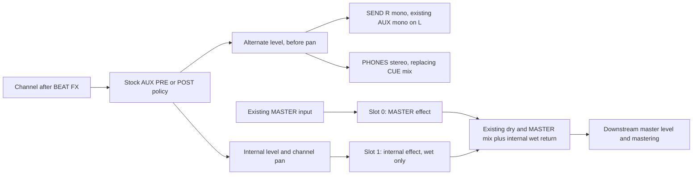

# Effects and DSP findings

This is the starting point for the MX-1 effect investigation. It separates
original-firmware observations, the additional-send implementation, and what
still needs decoding or physical measurement. The performance FX system has
**19 engines plus bypass**; its six panel buttons select 48 factory presets,
not six distinct DSP implementations.

## Reading map

| Question | Reference |
| --- | --- |
| What engines and parameters exist? | [Engine inventory, callback evidence and corrected counts](FX_ENGINE_PARAMETERS.md) |
| Which engines do the six buttons select? | [All six banks and eight variations per bank](FX_ENGINE_PARAMETERS.md#six-panel-banks-and-their-eight-variations) |
| What does the big knob actually change? | [Macro structure](FX_ENGINE_PARAMETERS.md#the-large-knob-is-a-macro) and [all 48 exact mappings](FX_MACRO_MAPPINGS.md) |
| What are the raw type/mode values? | [Decoded enumerations and unresolved types](FX_ENGINE_PARAMETERS.md#modetype-values) |
| How do the additional sends work? | [Controls, routing, placement and verification](FX_SENDS.md) |
| What was recovered from the DSP binary? | [Partial disassembly](DSP_DISASSEMBLY.md), [DSP0 listing](../analysis/esc2-disassembly/dsp0.txt), [DSP1 listing](../analysis/esc2-disassembly/dsp1.txt), [machine-readable report](../analysis/esc2-disassembly/report.json) |
| Why reserve an existing effect slot? | [Original slot-ownership investigation](FX_SENDS_RESEARCH.md#existing-effect-slots-are-owned-by-master-fx) and the current design below |
| What happened to the old ARM generators? | [Historical generator handoff](GENERATOR_RESEARCH.md) and [SDRAM placement investigation](SDRAM_CODE.md) |
| What is implemented and what remains untested? | [Mainline identity/layout](MAINLINE.md), [build report](../build/mainline/build-report.json), [roadmap](../ROADMAP.md) |

Channel BEAT FX, performance MASTER FX, and the downstream mastering chain are
separate systems. This inventory describes performance MASTER FX and its reuse
for the internal send. See [mastering documentation](MASTERING.md) for that
separate processor. No claim of complete firmware source recovery is made.

## Original effect organization

The six buttons each select eight records. Every record specifies **one engine**,
initial parameters, four macro targets/ranges for the large knob's right half,
four for its left half, and a TIME target. A side can select a discrete mode
and sweep several other controls together. Equal range endpoints mean a fixed
value; a zero target means an unused mapping. Center is the stock OFF position.
COMBI sequences effect selections over steps; it does not create a six-engine
chain. Some engines themselves combine stages: Oscillator exposes waveform,
filter and delay controls, and Spiral exposes two pitch/pre-delay voices.

Examples that distinguish preset names from actual engine ownership:

- Stereo Delay & Pan Delay selects the same Delay engine on both knob sides,
  changing its type to Pan on the left and Stereo on the right.
- Pitch Shift 1/2 use the engine named Spiral, with different preset/macro values.
- Room, Hall and Reverb Mod use the same Reverb engine, with type values 0, 3
  and 5 respectively.
- Tape Echo, Equalizer, Chorus and Reverser have firmware implementations but
  are not selected by any of the 48 stock records. Their existence is not a
  physical acceptance result for a newly exposed control surface.

Reverb has seven active engine controls. Oscillator has **nine**, correcting the
initial seven-control inventory: its null DUMMY record is followed by real
DD EFX LEVEL and NOISE LEVEL callbacks. Scatter's named Controls 1–3 instead
have branch chains that simply return; Controls 4–6 have real writers whose
musical names remain unresolved. [Registry evidence](FX_ENGINE_PARAMETERS.md#evidence-anchors).

## Two existing slots, rather than a new delay allocation

Original MASTER type changes alternate two already relocated effect instances.
Both execute on DSP1. Original constructors and writers distinguish their
program, coefficient, shared-port and data-descriptor bases:

| Resource | Slot 0 | Slot 1 | Address domain |
| --- | --- | --- | --- |
| Effect program entry | `0x4000` | `0x6000` | DSP1 logical program bytes |
| Coefficient base | `0x60` | `0x70` | DSP1 coefficient index |
| Shared-port base | `0x50` | `0xa8` | Original wrapper index |
| Eight-byte data-entry base | 4 | 39 | DSP1 descriptor index |
| Nonzero encoded base-address band, across stock algorithms | `0x491500..0x6372ff` | `0x637300..0x7fffff` | Driver address fields, **not asserted ARM byte addresses** |

The original stock ownership was the obstacle: disabling the DELAY menu alone
would not reserve a slot or prevent other MASTER selections from overwriting
it. The new implementation pins MASTER to slot 0 and uses slot 1 for the send.
It preserves the stock descriptor payloads and adds no third delay instance.
MASTER delay/reverb remains available. The cost is replacing the two-slot type
crossfade with brief MASTER bypass during loading; internal type changes clear
that bus's previous tail. Parameter/level changes do not reload the engine.

Separate descriptor bases, preserved payloads and loader-isolation checks
support this reuse. They do **not** establish complete dynamic delay-buffer
extents, installed memory capacity or arbitrary simultaneous-effect timing.
[Original relocation evidence](DSP_DISASSEMBLY.md#effect-instance-relocation),
[current slot policy](FX_SENDS.md#dsp-and-memory-design).

## New routing and execution

The new per-channel taps follow BEAT FX and precede pan. Both new send levels
follow the stock AUX PRE/POST choice: PRE ignores fader/mute; POST includes both.
The internal sum then applies the channel's stock pan/balance coefficients;
the alternate sum remains independent of pan.

Only the selected alternate destination is active; Off restores normal AUX and
headphone routing. PHONES retains headphone volume and restores the current
stock MIX setting on exit. The internal return joins after performance MASTER
FX, so it cannot feed MASTER or itself. This independent return must not be
confused with the physical AUX return's existing stock routing setting.

Two new DSP1 kernels perform the sample arithmetic. ARM control code executes
in the original parameter task after its queue drains; no new ARM sample-IRQ
renderer is installed. Original conditional slot calls and loader/mute ordering
remain in use. Return-validity gates suppress a slot during reprogramming;
internal factory settings and wet-only configuration finish before its gate
opens. Graph reload invalidation runs after the original stop and only writes
the normal graph's gates; diagnostic graphs are excluded.

The new internal send exposes direct parameter/time controls rather than the
large knob's four-way macros. Its fourth delay choice uses the Stereo initial
state of the Stereo/Pan preset; it does not reproduce that preset's left/right
type switching. Send levels/settings remain volatile, and External Mixer mode
disables the new buses. [Complete behavior and limitations](FX_SENDS.md).

## DSP encoding and binary coordinates

The partial decoder frames 4,393 packets in 77 original upload chunks, including
both slots for all twenty algorithm IDs. It preserves unknown instructions as
raw words. The low five header bits supply packet length in the examined
corpus; selected FE bindings and branch targets are annotated, not treated as
a complete control-flow or arithmetic reconstruction.

The new kernels use the smaller independently implemented A-arithmetic/FE-transfer
subset found in the original mixer. Parallel operations read packet-entry
register values, and loads become available to following packets. The emitter
checks register-write conflicts and transfer restrictions. Its numerical model
uses RAW32 quantization; relevant constants are unity `0x30000000`, half
`0x28000000` and negative unity `0xb0000000`. This is not IEEE float storage.
The ARM coefficient writer takes IEEE float arguments and the DSP representation
is a separate domain. [Emitter](../tools/extra_sends_dsp.py),
[numerical checks](../tools/extra_sends_verify.py),
[external ISA attribution and its limits](../PROVENANCE.md#additional-send-dsp-emitter).

All CPU addresses in these reports refer to **app_main** unless explicitly
stated otherwise. Resident runtime addresses equal decoded offsets plus
`0x60000000`; original relocated helpers use
`decoded = 0xd0b8c + runtime - 0x01000300`.
DSP program offsets are logical byte positions after the original uploader's
word ordering and partial-word handling. They must not be added directly to a
ROM source pointer as though the uploaded bytes were a flat copy.

The new mixer is 974 bytes at DSP1 `0x2000`; the output kernel is 324 bytes at
`0x2800`. They use coefficients `0x80..0x9a` and same-frame data words
`0x20b0..0x20b5`. Exact old/new bytes, source chunks and branch targets are in the
[build report](../build/mainline/build-report.json) and
[guarded patch integration](../tools/extra_sends_patch.py).

A 3,328-byte ARM-code/DSP-data payload occupies explicitly reserved SDRAM
`0x60664000..0x60666000`. Moving the heap start from `0x606634d0` to
`0x60666000` excludes 11,056 bytes including alignment/headroom; the heap end
stays `0x62000000`. New send state takes 40 SRAM bytes at
`0x010174e0..0x01017508`. Startup copy eight loads the payload. Original heap
creation/allocation-through-exhaustion checks establish exclusion, not peak
workload usage. Current sizes and candidate identity belong to the build report,
not to the historical generator report.

## Evidence and open questions

| Evidence | Establishes | Does not establish |
| --- | --- | --- |
| Original names, registry and factory records | Engine inventory, preset IDs, macro targets/ranges, available value labels | Musical meaning of unnamed controls; correctness of every display label |
| Original ARM uploader and callbacks | Word boundaries, instance relocation, writes, initialization/control paths | Physical DMA/FIFO completion, DSP audio or deadline margin |
| New numerical kernel model, 480 cases | Send arithmetic, pan/pre-post behavior, output destinations and return placement under the model | Complete execution of factory effects or physical delay RAM |
| Eight internal variations and 20 MASTER-loader isolation cases | Control/loading paths and preservation of opposite-slot program/coefficient/descriptor memory under the harness | Worst-case simultaneous MASTER/internal behavior on hardware |
| Original allocator and startup checks | Explicit reservation, initialization and allocation exclusion | Peak memory use or SDRAM execution latency |
| Full offline reproduction and committed-artifact gate | Rebuilt candidate and recorded evidence match | Installation, audio acceptance, recovery guarantee or hardware timing |

The current [send report](../build/mainline/extra-sends-verification.json) records
modeled boundaries: bulk program DMA, data-descriptor transport, delay clearing,
command completion, RTOS waits and selected parameter-database operations.
Factory program uploads run, but complete factory audio execution does not.
Instruction counts and packet counts are not timing measurements.

Unresolved work is explicit:

- Names/behavior for Reverb types 1, 2, 4 and 6; musical meanings of Scatter
  Controls 4–6; valid Scatter types beyond the factory-used patterns.
- Complete physical units, nonlinear scaling and ranges for each control.
  For example, DD SYNC's display text order conflicts with its writer: actual
  instructions use raw 1 for tempo-derived time and 0 for free time.
- Complete factory DSP arithmetic, dynamic delay addressing and memory extents.
- Physical audio, worst-case feedback/tails and processing margin with both FX
  slots, mastering and USB active at 44.1/48/96 kHz.
- Physical destination switching, COMBI/type/rate/mode reloads, headphone MIX
  restoration and zero-send dry equivalence.

The candidate remains UNTESTED. No device access is implied by documenting these
findings. The historical generator freezes are retained as hardware evidence;
they do not establish either failure or acceptance of the current DSP-only
sample arithmetic. [Bench procedure](HARDWARE_VALIDATION.md).
