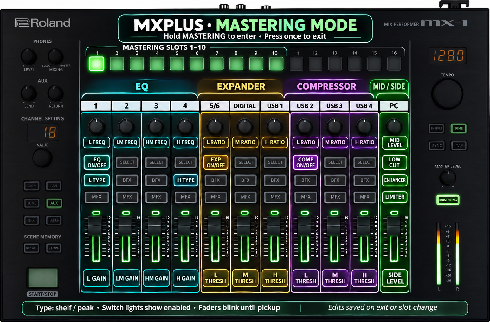

# Mastering mode

Hold **MASTERING**, press **TAP**, then release both buttons. Entry is immediate;
there is no timed hold. MASTERING must be pressed first. Press MASTERING once
while editing to save and return to the mixer.

MASTERING alone retains its stock short-press operation. MASTERING + TEMPO
still selects the stock preset. TAP alone reaches the original tap-tempo handler
immediately; the entry combination consumes TAP and both releases, so it does
not tap a new tempo. Pressing TAP first remains an ordinary tap-tempo action.

The held-key guard checks physical IDs `0..0x54` only, matching routing. The
user's mixer reported bit 85 set, which blocked the previous 88-bit check; the
[diagnostic observation and fix](../evidence/mastering-key-range-20261104/README.md)
are documented separately. This fix still awaits physical acceptance.

Entry is allowed from all six channel-setting pages: GAIN, PAN, TONE, AUX, BFX
and FADER (IDs 5–10), plus the existing control-surface page 15. Boot, lock,
modal and other pages remain excluded. Knob/fader samples and unrelated panel
notifications continue through their ordinary handlers while MASTERING is held.
Another button or encoder movement preserves the stock modified gesture.

The previous long-hold build still failed to enter on the user's mixer,
including after selecting GAIN. The page guard was independently too narrow,
but does not explain that complete observation. The
[chord change record](../evidence/mastering-chord-20261103/README.md) separates
that unresolved hardware behavior from the new button-combination tests.
The earlier [background-traffic fix](../evidence/mastering-hold-20261103/README.md)
is retained as historical evidence.

The mode takes over panel buttons, encoders, faders and scanned knobs. Step
pads **1–10** select the ten built-in mastering slots; the current slot lights.
Pressing the current pad does nothing. Pads 11–16 and other unassigned controls
do nothing. Overall mastering bypass is retained: turn mastering on before
entering if it is bypassed.

Strips below are numbered **left to right**, including DIGITAL and USB strips.
Every switch toggles on press. Its light shows enabled; for EQ type, off means
shelf and on means peak.

| Position | Printed strip | TONE/FILTER knob | Fader | SELECT | BFX | MFX |
| --- | --- | --- | --- | --- | --- | --- |
| 1 | 1 | Low frequency | Low gain | EQ on/off | Low shelf/peak | — |
| 2 | 2 | Low-mid frequency | Low-mid gain | — | — | — |
| 3 | 3 | High-mid frequency | High-mid gain | — | — | — |
| 4 | 4 | High frequency | High gain | — | High shelf/peak | — |
| 5 | 5/6 | Low expander ratio | Low expander threshold | Expander on/off | — | — |
| 6 | DIGITAL | Mid expander ratio | Mid expander threshold | — | — | — |
| 7 | USB 1 | High expander ratio | High expander threshold | — | — | — |
| 8 | USB 2 | Low compressor ratio | Low compressor threshold | Compressor on/off | — | — |
| 9 | USB 3 | Mid compressor ratio | Mid compressor threshold | — | — | — |
| 10 | USB 4 | High compressor ratio | High compressor threshold | — | — | — |
| 11 | PC | Mid level | Side level | Low-cut on/off | Enhancer on/off | Limiter on/off |

This sketch maps 22 continuous controls and eight switches. EQ Q, EQ input/output
levels, dynamics attack/release and all other unmapped parameters keep their
current values. The left display abbreviates the parameter name; the right
uses Roland's value formatter. Controls pick up their existing mastering value
before changing it. Assigned fader lights blink until pickup. Changing slots
resets pickup for all faders and knobs to prevent jumps into the new slot.

The overlay is a visual guide, not a print-to-scale panel template. It was made
with the built-in image generator using [this prompt](images/mastering-overlay-prompt.txt)
and Roland's [official top view](https://cdn.roland.com/assets/images/products/gallery/mx-1_top_gal.jpg)
as a geometry reference. Overlay colors group functions; they do not specify
new hardware LED colors.

Leaving restores the mixer display and holds each displaced control's mixer
value until its physical position crosses that value. Faders use the original
snapshot/pickup blink renderer. The extra pickup gate applies even when the
system fader setting is Jump; the stock setting itself is unchanged. Knobs also
pick up, without a new knob indicator. Linked follower strips retain their stock
behavior. Buttons held while leaving cannot trigger stock release actions.

Edits use the original parameter setter and notification path. Exiting calls
Roland's original save routine for the selected slot, as the stock hidden editor
does. Switching slots first saves the outgoing slot, then loads the next one
using the stock temporary-mute sequence. This saves the slot even if no control
was edited. There is no per-fader-movement storage write added here. Offline
checks establish slot copies and the storage submission payload, not successful
nonvolatile writes or power-cycle persistence. See the separate
[full effect parameter tables](MASTERING_PARAMETERS.md).

## Placement and original-instruction evidence

This is a control-task change, with no new sample callback. It reclaims part of
the existing mixer parameter-ID lookup, rather than placing executable code in
a new memory region. Neither the unsuccessful `0x01018000` experiment nor the
unvalidated reserved-SDRAM generator design is used. The history and unresolved
freeze cause remain in [the generator research](GENERATOR_RESEARCH.md).

All addresses below belong to **app_main**. Resident runtime addresses are
`0x60000000 + decoded-image offset`; the existing relocated SRAM slot and its
startup map are documented in [MAINLINE.md](MAINLINE.md).

| Main decoded offset | Runtime | Change or evidence |
| --- | --- | --- |
| `0x1dbd6..0x1dbf4` | `0x6001dbd6..0x6001dbf4` | Compress stock mixer ID lookup into 26 bytes; 30-byte slot |
| `0x1dbf4..0x1de08` | `0x6001dbf4..0x6001de08` | 532-byte slot for mastering redraw, constants and trampoline |
| `0x1de08` | `0x6001de08` | Preserve original `0x600b53ac` literal used at `0x6001dbca` |
| `0x1de0c..0x1e5ec` | `0x6001de0c..0x6001e5ec` | 2,016-byte slot for mastering control code |
| `0x1e5ec..0x1e65e` | `0x6001e5ec..0x6001e65e` | Preserve shared return and invalid-ID diagnostic path; callers at `0x6001e80a` and `0x6001e97c` |
| `0xf5d8` | `0x6000f5d8` | Registered event callback wraps the existing routing callback |
| `0xf5dc` | `0x6000f5dc` | Registered periodic callback wraps original `0x60010b76` |
| `0x1484a` | `0x6001484a` | Full-redraw entry veneer; trampoline reproduces displaced prologue and both conditional destinations |
| `0x108` | `0x60000108` | Extend startup BSS clear for 140 bytes of state at `0x01017444..0x010174d0` |

Original mixer lookup inputs `0..0x106` yield `n + 0x10f` below `0x73`, then
`n + 0x114`. The verifier executes the original and replacement for all 263
valid inputs, plus unsigned/signed boundary-invalid values and diagnostic calls.
It checks the external Ghidra references against the preserved literal/shared
return and scans literal words for additional pointers into the reclaimed body.
These checks support this exact revision, not a generic lookup replacement.

Original mastering lookup `0x6001f866` (decoded `0x1f866`) maps zero-based
indices `0..64` to parameter IDs `0x476..0x4b6`. The getter at `0x6001fa48`,
formatter at `0x6001fadc` and generic transaction setter at `0x600161f6` are
called with the original mastering object at `0x600b53b8`. The setter owns
clamping and notification. There is no direct DSP register write in the new UI.

Original SELECT rendering at `0x60014692` (decoded `0x14692`) uses logical
LED IDs `0x34..0x3e`; BFX/MFX rendering at `0x6001458e` (decoded `0x1458e`)
uses `0x3f..0x49` / `0x4a..0x54`. Their physical key ranges are respectively
`0x29..0x33`, `0x34..0x3e`, `0x3f..0x49`. Step keys 1–10 use logical LEDs
`0x19..0x22`. Key IDs must not be used directly as LED IDs.

The original hidden-editor MASTERING release at `0x6005aeb0..0x6005aebe`
(decoded `0x5aeb0..0x5aebe`) reads system index 1 from `0x600b5390` and calls
`0x6001fafa`. Actual instructions at `0x6001fafa..0x6001fb0c` tail-call
`0x6000c9c8` with group 6 and slot `selected + 1`. This copies live group-6
values to the selected slot and submits its 260-byte buffer through
`0x6000e1c2`. The ordinary setter instead edits group 6, slot 0. Therefore
using that setter alone is not evidence of durable preset storage.

Original preset loading at `0x6001fb4c` (decoded `0x1fb4c`) copies selected
slot `n + 1` into live slot 0. The new pad selector follows the temporary
SETUP index `0x24` mute/unmute around this call seen in the original shortcut
at `0x60017b20..0x60017b44` (decoded `0x17b20..0x17b44`). It also updates
system index 1 through the stock setter. These calls and RAM copies are tested
with the actual original instructions; the final storage worker is a boundary.

Callbacks retain the Cortex-M3 Thumb AAPCS convention. Function pointers set
Thumb bit 0; calls preserve r4–r11 and stack balance in the instruction tests.
Entry runs directly in the registered event callback on the TAP press. It no
longer reads the RTOS clock at `0x010037e8` or waits for the periodic callback.
The tests reject any clock call from the mastering gesture. The periodic wrapper
still preserves original work, redraw and modal-exit handling.
Stock fader and tone handlers are `0x600174f2` / `0x600175d4`; stock fader
blink rendering is `0x60014488` (decoded offsets subtract `0x60000000`).

[The build report](../build/mainline/build-report.json) records exact old/new
bytes, veneers, exported targets, section usage, relocation literals and all
component checksums. [The guarded sites](../patches/mastering_sites.json) contain
the exact original lookup bytes. Mastering uses the reclaimed resident lookup
space and adds 140 bytes of writable state. With the [MIDI descriptor](USB_MIDI.md),
the total reservation is now 620 bytes inside stock MPU region 2.
This mastering change adds no heap, MPU, USB-application, boot-program, updater
or panel-payload changes.

## Verification and limits

[mastering-verification.json](../build/mainline/mastering-verification.json)
executes the compiled registered callbacks, original parameter storage/getters/
clamping transactions and value formatter. It covers immediate chord entry without a tick, standalone MASTERING and TAP,
both release orders, repeats, interleaved ADC/background traffic, original
channel-setting button-to-page requests, page/modal/lock guards, all 22 analog assignments, eight switches and ranges, isolated controls,
held releases, return pickup in Jump and Pass modes, externally changed targets,
original tone/fader handling, blink encoding and the displaced redraw branches.
It also checks all ten slots, 65-value round trips, outgoing save payloads,
selected-pad LEDs, mute ordering, same-slot no-ops and renewed pickup.

Object constructors are represented by original vtables and initialized values.
The periodic callback body, mutex operations, parameter notification
boundaries, MIDI output, storage singletons/submission and final panel I/O are
stubbed. Save preparation and slot buffer copying execute unchanged. Physical LED timing,
DSP sound, task timing and mastering save/recall/restart are not established.
The full reproduction also checks the existing routing, startup, allocator,
USB and container boundaries. The artifact remains **UNTESTED**.

For an independently authorized bench run, add entry/exit while audio runs,
every mapped control, ten slot pads, bypass and preset shortcuts, held buttons,
both pickup modes,
linked channels, scene recall/restart and USB/routing regression to the existing
[hardware validation procedure](HARDWARE_VALIDATION.md). No hardware was accessed
for this implementation.
